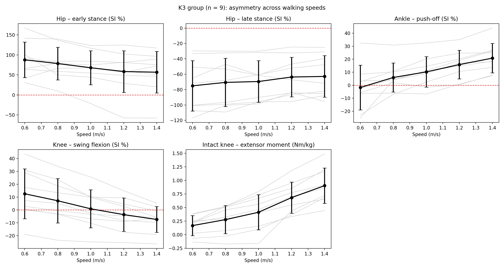
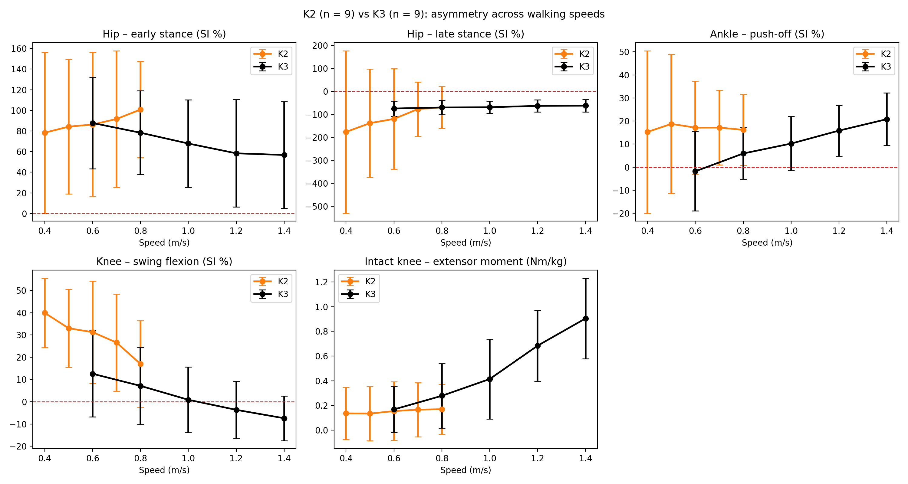

# Gait asymmetry in transfemoral amputees across walking speeds

**Question:** when a person with an above-knee amputation walks faster, does the asymmetry between the intact and the prosthetic limb increase?

**Data:** open dataset by [Hood et al. (2020), *Scientific Data*](https://www.nature.com/articles/s41597-020-0494-7) – 18 individuals with a unilateral above-knee amputation walking on an instrumented treadmill at 5 speeds. Data are not included in this repository; they can be downloaded from [figshare](https://doi.org/10.6084/m9.figshare.c.4962305) (the notebook downloads them automatically).

**Methods:** peak joint moments and angles at hip, knee and ankle for the intact and prosthetic side; symmetry index (SI); per-subject linear regression of each parameter against speed and one-sample t-test on the slopes (K3 group, n = 9, 0.6–1.4 m/s); comparison with the K2 group (n = 9) at the common speeds of 0.6 and 0.8 m/s (Welch's t-test).

**Main results (K3 group):**
- the intact knee extensor moment increases with speed in 9/9 subjects (p < 0.001);
- the push-off asymmetry at the ankle increases with speed in 9/9 subjects (p = 0.0007): the intact ankle provides the extra push-off, the prosthetic foot barely changes;
- the prosthetic knee adapts in swing flexion, but not in push-off.

**K2 vs K3:** at the common speeds (0.6 and 0.8 m/s) the two groups were similar, and in the K2 group (up to 0.8 m/s) the load on the intact limb did not clearly increase. The overload observed in the K3 group therefore seems related mainly to the higher walking speeds reached.

**Files**
- `Project_amputees.ipynb` – full analysis (Google Colab)
- `k3_SI_vs_speed.png` – main figure (K3 group)
- `K2_vs_K3.png` – K2 vs K3 comparison
- `report_gait_asymmetry.pdf` – short report (methods, results, discussion)

**Author:** Martina Agostini, BSc Biomedical Engineering, Politecnico di Milano
